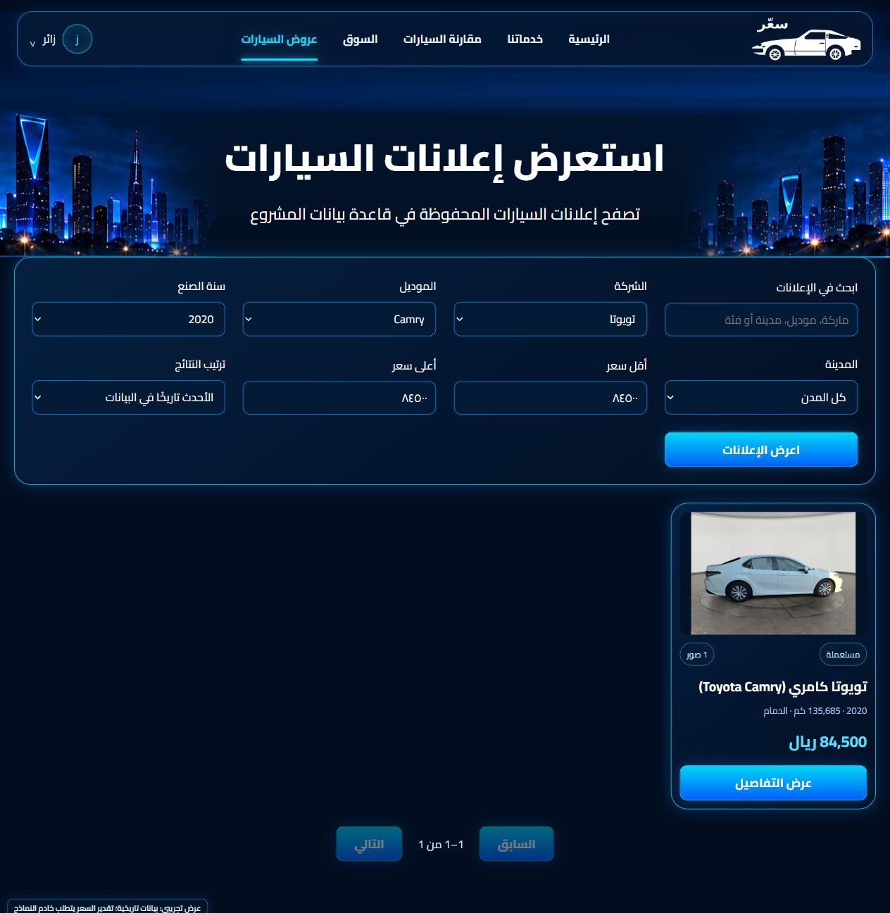
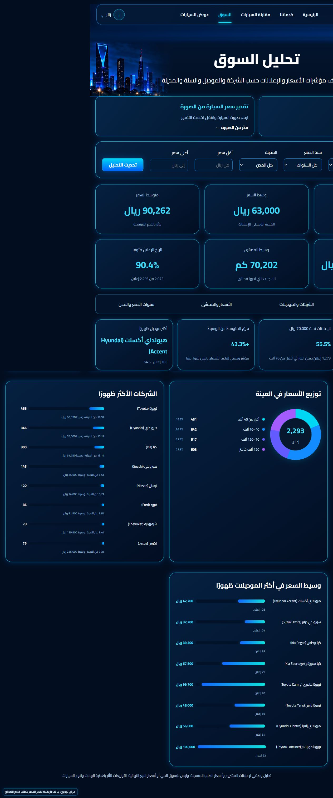
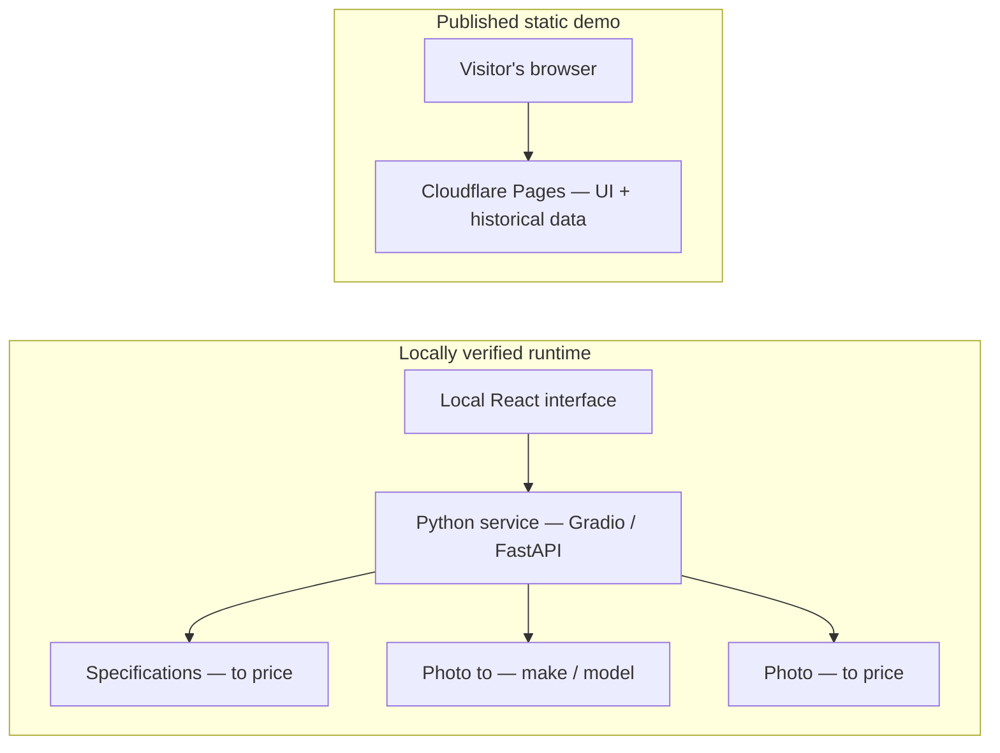

<div align="center">
  
  <h1>🚗 Saer | سعّر</h1>
  <p><strong>Know the car. Understand the price.</strong></p>
  <p>Estimate car prices, identify vehicles from photos, and explore historical listings.<br>An Arabic-first graduation project built around practical machine learning.</p>
  <p>
    
    
    
  </p>
  <p>
    <a href="https://saer-rmsavg637.pages.dev/?api=https%3A%2F%2Fgigantic-jolliness-stamina.ngrok-free.dev"></a>
  </p>
  <h3><a href="https://saer-rmsavg637.pages.dev/?api=https%3A%2F%2Fgigantic-jolliness-stamina.ngrok-free.dev">🌐 Explore the Live Demo →</a></h3>
  <p><a href="#features">✨ Features</a> · <a href="#quick-start">🚀 Quick Start</a> · <a href="#team">👥 Team</a> · <a href="#documentation">📚 Documentation</a></p>
</div>

> 🌐 **Try Saer:** Open the demo above and choose guest access. The link selects the external model service; predictions require its server and tunnel to remain running. Local model verification does not guarantee availability of every live flow. The deployed interface may differ from the latest `main`.


Saer brings vehicle exploration and price estimation into one Arabic, right-to-left interface. Browse recorded advertisements, compare cars, narrow a budget, or run the locally verified models with a vehicle photo or its specifications. Estimates refer to asking prices in the training data—not guaranteed sale prices.

<details>
<summary><strong>See the listings explorer and market dashboard</strong></summary>

**Historical listings explorer** — a real filter applied to the bundled sample listing. The displayed amount is a recorded asking price, not a prediction.



**Market analysis** — descriptive summaries and charts computed from historical advertisement data.



</details>

*These are actual screenshots of the local application on `main`, not design mockups or proof of live model hosting. [Capture details](docs/assets/README.md).*

<a name="features"></a>

## ✨ Features

| Feature | What you can do | Data / runtime |
|---|---|---|
| **💰 Specification-Based Price Estimation** | Enter vehicle details to estimate an asking price in SAR. | Local model service |
| **📷 Image-Based Price Estimation** | Upload a car photo for an experimental price estimate and prediction ranges. | Local model service |
| **🎯 Budget-Based Recommendations** | Find up to five distinct model choices within a budget. | Historical listings |
| **⚖️ Car Comparison** | Compare recorded vehicle attributes and advertised prices side by side. | Historical listings |
| **📊 Market Analysis** | Explore descriptive price summaries by make, model, year, and city. | Historical listings |
| **🔎 Historical Listings Explorer** | Search and filter the project’s saved advertisements. | Historical listings |

**Two photo paths, two different purposes.** Vehicle identification suggests a make and model for the specification-based flow. The user confirms that suggestion and completes fields such as year and mileage before pricing. Direct image-to-price estimation is a separate model; it does not infer mileage or mechanical condition.

## 🧠 Models & Data

The table below describes the **saved runtime artifacts**, rather than the alternative architectures proposed in early planning documents.

| Model | Actual architecture | Input → output | Runtime requirement |
|---|---|---|---|
| **Specification price** | `HistGradientBoostingRegressor` with an `OrdinalEncoder` and the project’s feature preprocessing | Vehicle specifications → experimental asking-price estimate in SAR | Main Python environment; scikit-learn **1.9.1** |
| **Vehicle identity** | Frozen **DINOv2 ViT-S/14 + CLIP ViT-B/32** features; `StandardScaler` + `LogisticRegression`, with 59 joint make/model classes | One photo → joint make/model suggestion and uncalibrated scores | Main environment + restored public encoders and detection support weights |
| **Image price** | Three-regressor **SVR / Ridge ensemble** over frozen **DINOv2 S/B/L + CLIP ViT-B/16** embeddings | Vehicle photo(s) → experimental SAR estimate and 80% / 90% prediction ranges | Separate image-worker environment; scikit-learn **1.6.1** + restored encoders |

- **2,742 historical advertisements** and **13,416 image records** are included as structured data.
- The repository bundles **one original dataset photo**. Image records are metadata; the complete advertisement photo collection is **not included**. Most local demo listings use a placeholder. [Sample scope](docs/SAMPLE_IMAGES.md).
- The three approved runtime artifacts total **5.64 MiB**. Public pretrained encoder weights are separate—about **2.72 GiB**—and must be restored. [Artifacts](docs/runtime-assets.json) · [Encoder inventory](docs/PUBLIC_ENCODERS.md).

Evaluation is retrospective and does not establish external-market accuracy. A sample prediction is not an accuracy metric, and an identity score is not calibrated confidence. See the [image-price evaluation and provenance](models/image_price_current.json), [identity selection and caveats](models/identity_current.json), and [tabular validation metadata](models/improvement_20261021T093545513846/price/selected.json).

## 🏗️ How It Fits Together

| Layer | Technology |
|---|---|
| Interface | React · TypeScript · Vite · Arabic RTL |
| Model services | Python · FastAPI REST · Gradio |
| Machine learning | scikit-learn · PyTorch · torchvision · Transformers |
| Data | SQLite · CSV · static JSON exports |
| Published demo | Cloudflare Pages, using Direct Upload for static assets |



Cloudflare serves the static demo; it does **not** run Python or the models. Demo-mode UI inference uses Gradio. REST endpoints are also available for direct verification. The live-demo link supplies an external model-service URL through `?api=`. Its availability depends on the running model server and tunnel; this README update does not claim a new end-to-end inference test.

<a name="quick-start"></a>

## 🚀 Quick Start

### 1. Explore the interface locally

From a fresh clone, in **PowerShell**. Tested with Node **24.22.1** and pnpm **11.25.0**:

```powershell
git clone https://github.com/rayan18q-bot/saer.git
cd saer
pnpm --dir frontend install --frozen-lockfile
Copy-Item frontend/.env.example frontend/.env.local
pnpm --dir frontend dev
```

Open **http://127.0.0.1:5173** and choose guest access. Historical browsing does not require a model server. Repository access is required while the repository is private.

### 2. Enable local model inference

From the **repository root**, use Python **3.12** and two fresh environments. The image worker is isolated because its saved artifact requires a different scikit-learn version.

```powershell
Remove-Item Env:PYTHONPATH -ErrorAction SilentlyContinue
Remove-Item Env:SAER_IMAGE_PYTHONPATH -ErrorAction SilentlyContinue
$env:PYTHONNOUSERSITE='1'
py -3.12 -m venv .runtime/clean-main
py -3.12 -m venv .runtime/clean-image
.runtime/clean-main/Scripts/python.exe -m pip install -r requirements-runtime-lock.txt
.runtime/clean-image/Scripts/python.exe -m pip install -r requirements-image-lock.txt
.runtime/clean-main/Scripts/python.exe tools/restore_public_encoders.py --download
./tools/start_runtime.ps1 -Mode gradio
```

With the frontend still running, open:

**http://127.0.0.1:5173/?api=http%3A%2F%2F127.0.0.1%3A7863**

The first encoder restore needs internet access and disk space. After restoration, the launch script verifies the cache and starts offline inference. It reports an error when assets or the service are unavailable; it does not substitute saved predictions.

**[Full setup guide →](docs/SETUP.md)** includes environment checks, exact CPU versions, REST startup, configuration, fresh-result verification, build commands, and backup restoration. The tested platform is Windows x64 with 16 GB RAM; other platforms and GPU configurations have not been verified with these locks.

<a name="team"></a>

## 👥 The Team

- ريان القحطاني
- محمد ال حمود
- عبد الرحمن الاسمري

## 🗂️ Repository Guide

| Path | Purpose |
|---|---|
| [`frontend/`](frontend/) | Arabic RTL interface, design assets, and historical demo exports |
| [`backend/`](backend/) · [`hf_backend/`](hf_backend/) | REST API and the Gradio model service |
| [`models/`](models/) · [`outputs/`](outputs/) | Approved runtime artifacts, pointers, and model code |
| [`data/`](data/) | Selected processed tables and the SQLite seed; not the full photo dataset |
| [`scripts/`](scripts/) · [`tools/`](tools/) | Existing ML code, runtime workers, verification, and recovery tools |
| [`tests/`](tests/) · [`docs/`](docs/) | Frontend behavior tests, setup guides, and verification records |

<a name="documentation"></a>

## 📚 Documentation

| Start here | Details |
|---|---|
| [Setup & configuration](docs/SETUP.md) | Reproducible PowerShell instructions and operating notes, in English |
| [Model design & scope](ML_SPEC.md) | Original design and subsequent model decisions; early alternatives are not all implemented |
| [Data contract](DATA_CONTRACT.md) | Dataset conventions, cleaning, and provenance requirements |
| [Verification after unification](docs/UNIFICATION_VERIFICATION.json) | Actual build, frontend, and local model checks |
| [Reproducibility report](docs/PHASE4_REPRODUCIBILITY.md) | Independent environments, cache use, and remaining installation limits |
| [Delivery & presentation guide](DELIVERY.md) | Current handoff state, demonstration steps, snapshots, and history |
| [Project progress](PROGRESS.md) | Dated implementation and verification records |

<details>
<summary><strong>Scope, limitations & attribution</strong></summary>

- Recorded asking prices are historical, not live offers or completed sale prices.
- Not every flow, device size, or external image source has been tested. Cached encoders were verified; a complete fresh download on another machine remains untested.
- The separate image-price artifact retains its upstream provenance in [the model pointer](models/image_price_current.json). Identity diagnostics mentioned in older metadata are not additional active models in the interface.
- The Cairo font includes its [SIL Open Font License](frontend/public/fonts/OFL.txt). No repository-wide software license is declared, and no blanket redistribution rights are asserted for third-party model weights or vehicle/design imagery. Review the existing provenance and permissions before redistribution.
- Earlier phase reports describe the state at their dates. Current runtime instructions live in [Setup](docs/SETUP.md); branch histories and delivery checksums belong in [Delivery](DELIVERY.md).

</details>
